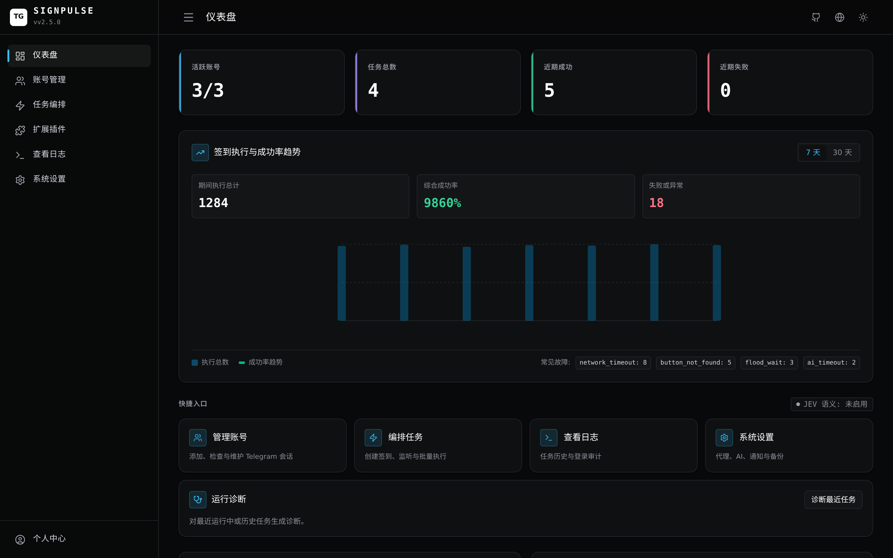
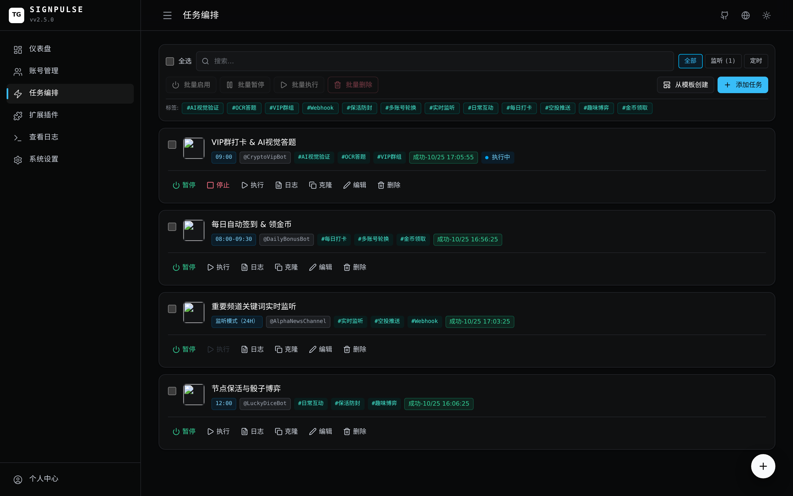
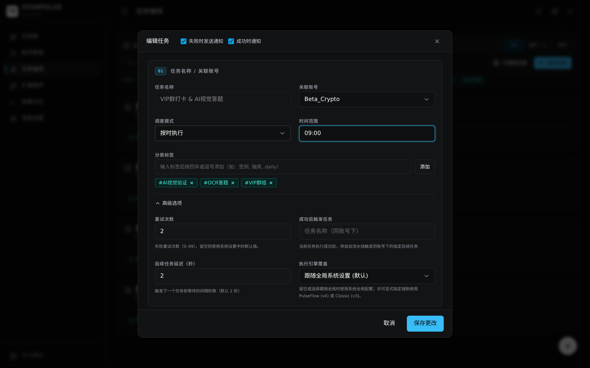
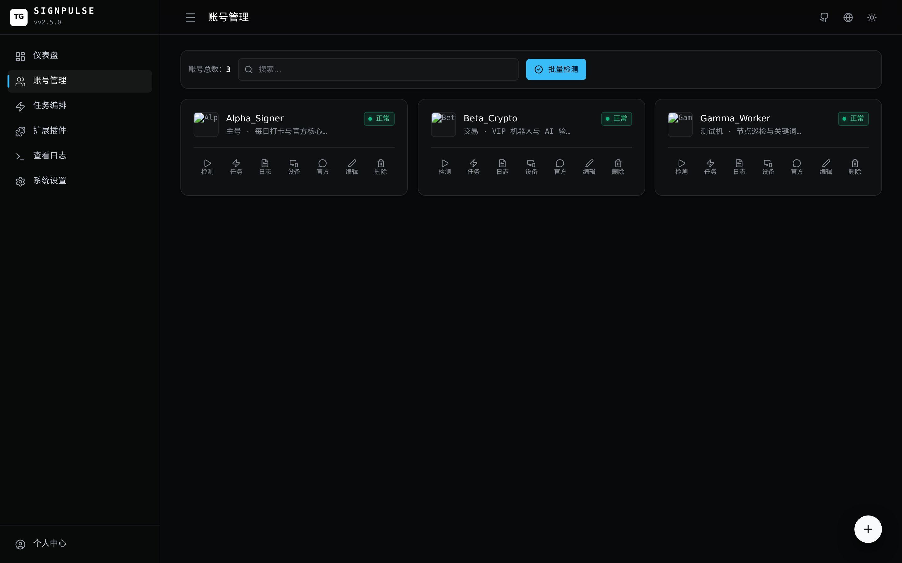
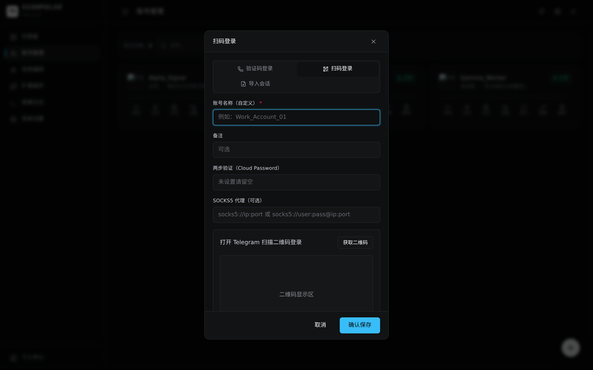
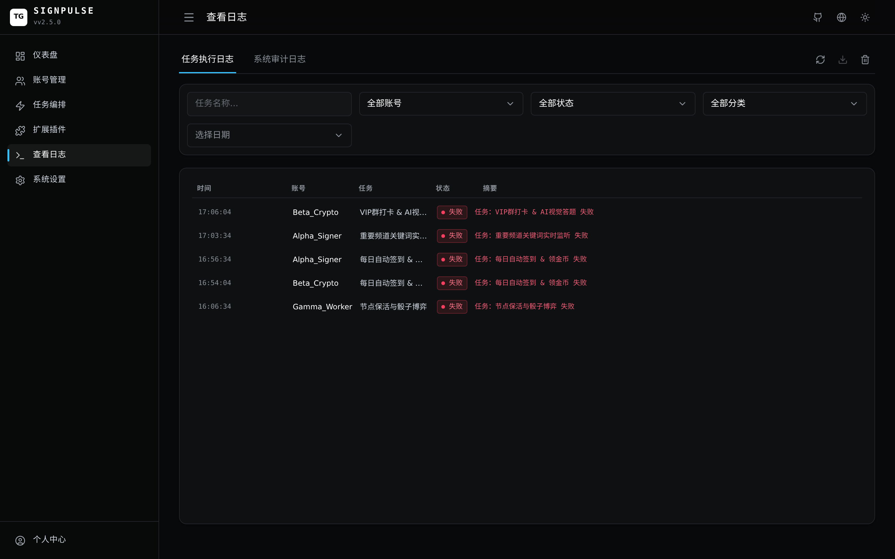
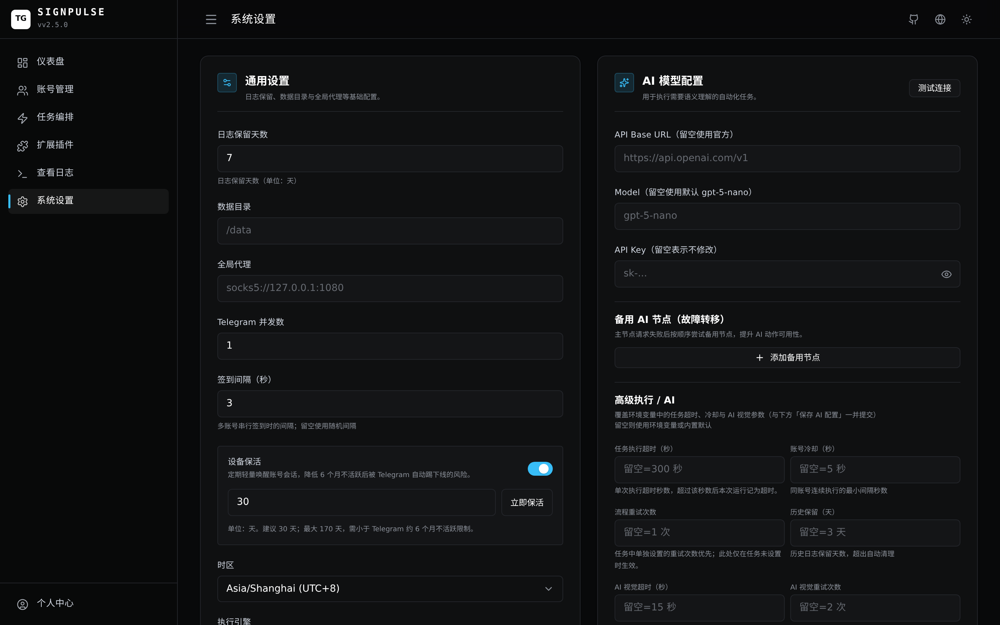
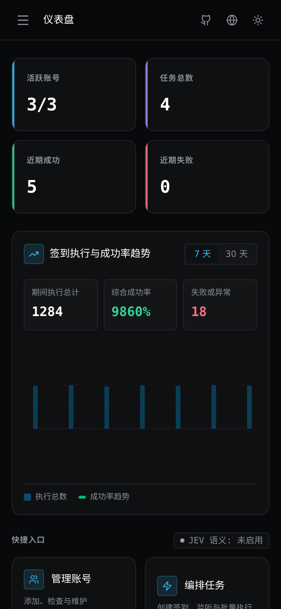

<p align="center">
  
</p>

<h1 align="center">TG-SignPulse</h1>


<p align="center">
  <strong>Telegram 多账号自动化管理面板</strong><br>
  签到 · 消息编排 · 关键词监听 · AI 验证 · JEV 语义决策
</p>

<p align="center">
  <a href="https://github.com/Silentely/TG-SignPulse/blob/main/LICENSE"></a>
  
  
  <a href="https://github.com/Silentely/TG-SignPulse/pkgs/container/tg-signpulse"></a>
  <a href="https://tg.cosr.eu.org/"></a>
</p>

<p align="center">
  <a href="https://tg.cosr.eu.org/"><strong>在线文档</strong></a>
  ·
  <a href="README_EN.md">English</a>
  ·
  <a href="https://tg.cosr.eu.org/guide/quick-start">快速开始</a>
</p>

---

## 项目简介

TG-SignPulse 是一个 Telegram 自动化管理面板。你可以在网页中管理多个 Telegram 账号，配置自动签到任务，并让任务按固定规则或随机时间段每天自动执行。

> 🤖 **AI 与语义决策**：已集成 OpenAI 兼容多模态接口（识图 / 计算题 / OCR），并搭载专为 Telegram 交互打造的原生 **JEV 语义决策引擎**（SystemOne 协议，支持内联按钮语义匹配、三态熔断降级与规则自愈建议）。

---

## 界面预览

<p align="center">
  
</p>

<details open>
<summary><strong>📸 点击展开/折叠功能截图导览</strong></summary>
<br>

| 模块 | 功能说明与视觉预览 |
| :--- | :--- |
| **任务编排管理**<br>· 支持固定时间、时间段随机与实时监听模式<br>· 智能 Jitter 错峰与自适应冷却倒计时<br>· 多账号轮换执行与任务标签体系 | <a href="docs/public/screenshots/tasks.png"></a> |
| **动作流与 AI 验证配置**<br>· 拖拽式编排动作序列：文本指令、内联按钮点击<br>· AI 视觉集成：OCR 识别、算术题推理与自动点按<br>· 单步重试、容错跳过与延迟间隔细粒度调控 | <a href="docs/public/screenshots/task-editor.png"></a> |
| **多账号管理与设备指纹**<br>· 多账号会话统一维护，网络延迟与心跳监控<br>· 独立 SOCKS5/HTTP 代理绑定与出口 IP 校验<br>· 设备指纹伪装（macOS / Android / Windows）与批量巡检 | <a href="docs/public/screenshots/accounts.png"></a> |
| **快捷扫码与会话导入**<br>· 官方二维码一键扫码登录，免输入手机号<br>· 支持 Telethon / Pyrogram `.session` 与 StringSession 免收码导入<br>· 密码 2FA 二次校验与会话有效性即时检测 | <a href="docs/public/screenshots/account-modal.png"></a> |
| **实时运行日志与可观测**<br>· SSE 实时流式日志推送，毫秒级状态同步<br>· 11 类细粒度失败分类与自动排障建议<br>· 支持按账号、任务、时间范围快速检索与一键导出 | <a href="docs/public/screenshots/logs.png"></a> |
| **系统设置与 WebDAV 灾备**<br>· 多渠道通知矩阵（Telegram Bot、飞书、钉钉、Discord）<br>· 坚果云 / Nextcloud 自动加密灾备（`.spbak` 格式）<br>· 全局调度并发、防风控静默时段与 API 参数热更新 | <a href="docs/public/screenshots/settings.png"></a> |
| **PWA 移动端自适应**<br>· 原生级移动端流式布局，完美适配手机触摸屏<br>· 支持添加至主屏幕（PWA），随时随地查看看板与启停任务 | <p align="center"><a href="docs/public/screenshots/mobile.png"></a></p> |

</details>

---

## 功能概览

| 模块 | 能力 |
|------|------|
| **账号管理** | 多账号登录（短信/二维码/Session导入）、代理配置、状态检测、重新登录、设备指纹画像 |
| **任务编排** | 定时/随机/监听触发，动作拖拽重排、步骤容错与条件跳过、安全宏模板 (AST 求值) |
| **动作类型** | 发送文本、点击按钮、发送骰子、AI 识图/计算、关键词监听、自定义插件动作 |
| **JEV 语义决策** | SystemOne 语义决策协议，高鲁棒性按钮匹配、三态熔断器 (`closed`/`half_open`/`open`) 自动降级与智能规则优化建议 |
| **任务重试** | 每个任务可独立配置重试次数（0–99），失败后自动从断点继续 |
| **账号与分组** | 多账号登录、标签分类管理、Telegram FloodWait 智能冷却退避保护 |
| **话题支持** | 群组 Thread ID 级别的发送与回复过滤 |
| **关键词监听** | 包含/完全匹配/正则，命中后支持 Telegram Bot、转发、Bark、自定义 Webhook、后续动作 |
| **时区管理** | Web 面板可切换时区（支持 22 个常用时区），调度器自动适配 |
| **通知推送** | 任务/账号状态通知，支持 Telegram Bot、企微、飞书、钉钉、Discord 多渠道矩阵 |
| **ChatOps 与运维**| TG Bot 双向指令控制 (/status, /run 等)、趋势大盘、WebDAV 远端备份与归档导出 |

---

## 技术栈

```
┌─────────────────────────────────────────────────────────┐
│  Frontend          Vue 3 + Vue Router + Pinia           │
│                    Tailwind CSS 4 + Lucide Icons         │
│                    Vite + PWA                            │
├─────────────────────────────────────────────────────────┤
│  Backend           FastAPI + Uvicorn                     │
│                    SQLAlchemy + SQLite (WAL)             │
│                    APScheduler (AsyncIO)                 │
│                    JWT + TOTP 2FA + bcrypt               │
├─────────────────────────────────────────────────────────┤
│  Telegram Engine   Pyrogram / Kurigram                   │
│                    Session File / String 双模式          │
├─────────────────────────────────────────────────────────┤
│  AI & Semantic     OpenAI SDK (多模态识图 / OCR / 计算题)│
│                    JEV 语义决策引擎 (SystemOne / 熔断器) │
├─────────────────────────────────────────────────────────┤
│  Infrastructure    Docker Multi-stage Build              │
│                    GitHub Actions CI/CD                  │
│                    GHCR Container Registry               │
└─────────────────────────────────────────────────────────┘
```

---

## 快速开始

### 前置条件

- Docker 24+ 与 Docker Compose
- 至少一个 Telegram 账号

### 一条命令启动

```bash
docker run -d \
  --name tg-signpulse \
  --restart unless-stopped \
  -p 8080:8080 \
  -v $(pwd)/data:/data \
  -e TZ=Asia/Shanghai \
  -e APP_SECRET_KEY=$(openssl rand -base64 32) \
  -e ADMIN_PASSWORD=your_strong_password \
  ghcr.io/silentely/tg-signpulse:latest
```

### Docker Compose

```yaml
services:
  app:
    image: ghcr.io/silentely/tg-signpulse:latest
    container_name: tg-signpulse
    restart: unless-stopped
    ports:
      - "8080:8080"
    volumes:
      - ./data:/data
    environment:
      - TZ=Asia/Shanghai
      - APP_SECRET_KEY=your_secret_key
      - ADMIN_PASSWORD=your_strong_password
```

```bash
docker compose up -d
```

### 登录面板

浏览器打开 `http://服务器IP:8080`

- 用户名：`admin`
- 密码：你设置的 `ADMIN_PASSWORD`（未设置则查看 `data/.admin_bootstrap_password`）

---

## 项目结构

```text
TG-SignPulse/
├── backend/            # FastAPI 后端
│   ├── api/            #   API 路由层（含 semantic.py 语义决策）
│   ├── core/           #   配置、认证、数据库
│   ├── models/         #   SQLAlchemy 数据模型
│   ├── services/       #   业务逻辑层（含 semantic/）
│   ├── scheduler/      #   APScheduler 调度器
│   └── utils/          #   工具函数
├── tg_signer/          # Telegram 自动化引擎
│   ├── core/           #   签到执行核心（client 客户端生命周期 / runtime 执行器）
│   ├── semantic/       #   JEV 语义客户端与 SystemOne 协议
│   ├── config.py       #   任务配置模型 (V1→V2→V3)
│   └── ai_tools.py     #   AI 工具集成
├── frontend/           # Vue 3 前端
│   ├── src/
│   └── vite.config.ts
├── docker/             # Docker 入口脚本
├── docs/               # 项目文档
├── Dockerfile          # 多阶段构建
├── docker-compose.yml  # Compose 编排
└── pyproject.toml      # Python 项目配置
```

---

## 文档

完整文档见 **[https://tg.cosr.eu.org](https://tg.cosr.eu.org/)**，常用入口：

| 入口 | 说明 |
|------|------|
| [快速开始](https://tg.cosr.eu.org/guide/quick-start) | 部署并创建第一个任务 |
| [Docker 部署](https://tg.cosr.eu.org/deploy/docker) | 镜像、Compose、升级 |
| [JEV 语义决策](https://tg.cosr.eu.org/guide/jev) | SystemOne 语义决策、三态熔断与规则自愈建议 |
| [配置参考](https://tg.cosr.eu.org/reference/configuration) | 环境变量、数据目录 |
| [运维手册](https://tg.cosr.eu.org/reference/ops) | 健康检查、备份、上线清单 |
| [任务编排](https://tg.cosr.eu.org/guide/tasks) | sign-tasks、动作类型 |
| [常见问题](https://tg.cosr.eu.org/faq) | 排障与说明 |

---

## 常用环境变量

| 变量 | 说明 | 默认值 |
|------|------|--------|
| `APP_SECRET_KEY` | JWT 密钥（生产必设） | 自动生成 |
| `ADMIN_PASSWORD` | 管理员初始密码 | 随机生成 |
| `APP_DATA_DIR` | 数据目录 | `/data` |
| `APP_DATABASE_URL` | 可选；空=SQLite，可设 Postgres URL | 空 |
| `TZ` | 时区 | 容器 `Asia/Shanghai`；代码默认 `Asia/Hong_Kong` |
| `TG_SESSION_MODE` | 会话模式 `file`/`string` | `file` |
| `TG_GLOBAL_CONCURRENCY` | 全局并发数 | `自动（CPU核心数，上限5）` |
| `TG_PROXY` | Telegram 全局代理 | 无 |
| `ENABLE_API_DOCS` | 启用 Swagger UI 与 OpenAPI 规范文档（默认关闭以加固安全） | `false` |

更多配置请查看 [配置参考](https://tg.cosr.eu.org/reference/configuration)。

---

## 本地开发

```bash
# 后端
python -m venv .venv
source .venv/bin/activate  # Windows: .venv\Scripts\activate
pip install -e ".[dev]"
uvicorn backend.main:app --reload --port 8080

# 前端
nvm use
cd frontend
npm ci
npm run dev
```

- Python 3.10–3.13（推荐 3.12）
- Node.js 22.23.1（以仓库 `.nvmrc` 为准，不支持跨主版本开发）
- 不建议使用 Python 3.14+（Telegram 运行时依赖尚未兼容）

---

## 健康检查

```bash
curl http://127.0.0.1:8080/healthz   # 快速健康检查
curl http://127.0.0.1:8080/readyz    # 服务就绪检查
```

---
## 致谢

本项目基于 [tg-signer](https://github.com/amchii/tg-signer) by [amchii](https://github.com/amchii) 进行重构与扩展。

---

## License

[BSD-3-Clause](LICENSE)
