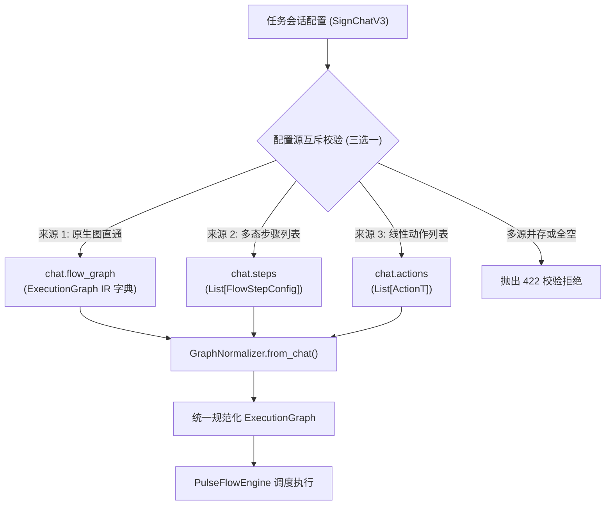

# 控制节点配置化设计规范 (Control Nodes Configuration Design)

## 1. 概述与背景
目前 TG-SignPulse 在底层执行引擎（`tg_signer/core/flow_models.py` 与 `tg_signer/core/flow_engine.py`）中已具备了完整的流程节点体系（`ActionNode`, `ConditionNode`, `WaitEventNode`, `DelayNode`, `ExtractorNode`, `SubflowNode`, `ParallelNode`）。
然而在任务配置层（`SignChatV3`、API、前端），任务配置仅能表达线性动作列表（`actions`）或单一动作步骤（旧版 `steps` 强约束 `action_type: SupportAction`），导致 `GraphNormalizer` 只能产出 `ActionNode`。

本规范定义**阶段一：控制节点配置化**的完整生产级架构，打通从任务配置到全部 7 种控制流节点的接线，同时保证历史任务 100% 平滑向后兼容、零隐性降级，并建立端到端的数据契约、安全资源限制与可视化预览闭环。

---

## 2. 总体架构与数据契约

### 2.1 三路输入互斥与优先级设计
任务会话配置层（`SignChatV3`）支持三路独立的配置来源，并在模型层执行**严格的三选一互斥校验**：



#### 规则定义：
1. **合法性条件**：`flow_graph`、`steps`、`actions` 必须且只能有一个非空（非 None 且长度/节点数 > 0）。
2. **冲突拒绝**：若同时提供多个非空来源（如既传入 `actions` 又传入 `flow_graph`），直接拒绝抛出 `ValueError` / HTTP 422，杜绝静默覆盖。
3. **旧版步骤兼容**：为避免破坏已有使用旧版工作流引擎的任务，**独立保留 `WorkflowStepConfig`**，新多态步骤采用独立的 `FlowStepConfig`。当解析 `steps` 时：
   - 若元素具有明确的 `node_type`，或不含单一 `action_type` 约束，使用 `FlowStepConfig`；
   - 若元素为旧版单动作步骤结构，保持原样解析，并在 Normalizer 阶段平滑映射。

---

### 2.2 轨道一：原生图直通 (`flow_graph`)
在 `SignChatV3` 中新增：
```python
flow_graph: Optional[Dict[str, Any]] = None
```
- **契约定义**：结构严格符合 `ExecutionGraph` 模型字典（包含 `entry_node_id`, `nodes`, 可选 `max_total_steps`, `error_handler_node_id`, `resume_from_node_id`）。
- **拒绝未知节点类型**：反序列化时严格校验 `node_type`，未知类型必须抛出异常拒绝，禁止静默降级为 `ActionNode`。

---

### 2.3 轨道二：多态步骤模型 (`FlowStepConfig`)
在 `tg_signer/config.py` 中新增独立的 `FlowStepConfig` 模型：

```python
class FlowNodeType(str, Enum):
    ACTION = "action"
    CONDITION = "condition"
    WAIT_EVENT = "wait_event"
    DELAY = "delay"
    EXTRACTOR = "extractor"
    SUBFLOW = "subflow"
    PARALLEL = "parallel"


class FlowStepConfig(BaseModel):
    step_id: str
    node_type: FlowNodeType = FlowNodeType.ACTION
    name: Optional[str] = None
    next_step_id: Optional[str] = None
    on_failure_step_id: Optional[str] = None
    terminal_policy: TerminalPolicy = TerminalPolicy.IGNORE
    terminal_branch_target: Optional[str] = None
    run_if: Optional[str] = None
    skip_if: Optional[str] = None
    timeout_seconds: float = 25.0
    retry_policy: RetryPolicy = Field(default_factory=RetryPolicy)
    loop_policy: LoopPolicy = Field(default_factory=LoopPolicy)

    # 1. Action 专用
    action_type: Optional[SupportAction] = None
    params: Dict[str, Any] = Field(default_factory=dict)
    config: Optional[Dict[str, Any]] = None  # 兼容旧版 config 字段输入

    # 2. Condition 专用
    cases: List[Dict[str, str]] = Field(default_factory=list)  # [{"condition": "...", "target_id": "..."}]
    default_target_id: Optional[str] = None

    # 3. WaitEvent 专用
    event_type: str = "NEW_MESSAGE"
    filter_patterns: List[str] = Field(default_factory=list)

    # 4. Delay 专用
    delay_seconds: float = 1.0

    # 5. Extractor 专用
    source_field: str = "prev.output"
    regex: str = ""
    export_vars: Dict[str, str] = Field(default_factory=dict)

    # 6. Subflow 专用
    subflow_graph: Optional[Dict[str, Any]] = None
    subflow_id: Optional[str] = None
    input_vars: Dict[str, str] = Field(default_factory=dict)
    output_vars: Dict[str, str] = Field(default_factory=dict)

    # 7. Parallel 专用
    branches: List[Dict[str, Any]] = Field(default_factory=list)
    parallel_mode: ParallelMode = ParallelMode.ALL
    max_concurrency: Optional[int] = None
    join_strategy: str = "merge"
```

---

## 3. 7 类节点字段到 IR 的完整闭环映射

| 节点类型 | 配置字段 (`FlowStepConfig`) | 底层 IR 模型 (`flow_models.py`) | 转换与规范化规则 |
|---|---|---|---|
| **Action** | `action_type`, `params`, `config` | `ActionNode(action_type, params)` | 若提供 `config`，自动合并至 `params`；`action_type` 统一转为大写枚举字符串；保留原始动作对象至 metadata |
| **Condition** | `cases`, `default_target_id` | `ConditionNode(cases, default_target_id)` | target_id 自动解析哨兵（`COMPLETE` / `FAIL`）；cases 中的 target_id 必须通过拓扑存在性校验 |
| **WaitEvent** | `event_type`, `filter_patterns`, `timeout_seconds` | `WaitEventNode(event_type, filter_patterns)` | **关键注入**：Normalizer 必须自动从会话上下文注入 `metadata={"chat_id": chat.chat_id, "account": ...}`，彻底规避运行期找不到 chat_id 的问题 |
| **Delay** | `delay_seconds` | `DelayNode(seconds)` | `delay_seconds` 必须大于等于 0 且小于等于单步最大超时限制 |
| **Extractor** | `source_field`, `regex`, `export_vars` | `ExtractorNode(source_field, regex, export_vars)` | 静态编译验证 `regex` 正则表达式有效性，杜绝运行期 ReDoS 或 SyntaxError |
| **Subflow** | `subflow_graph`, `input_vars`, `output_vars` | `SubflowNode(subflow_graph, ...)` | 递归反序列化并校验子图；禁止循环自引用；限制嵌套深度不超过 3 层 |
| **Parallel** | `branches`, `parallel_mode`, `max_concurrency`, `join_strategy` | `ParallelNode(branches, mode, max_concurrency, join_strategy)` | 递归校验每个分支子图；`parallel_mode` 映射为 `ParallelMode` 枚举；`max_concurrency` 范围校验 (1~10) |

### 公共控制策略映射：
- `retry_policy`: 统一转为 `RetryPolicy(max_attempts=..., backoff_seconds=..., retry_on_exceptions=...)`。
- `loop_policy`: 明确分离：`allow_loop` 允许节点被后续步骤回跳；`max_visits` 限制单流程内最大访问次数（防死循环）。
- `terminal_policy`: 枚举类型 `TerminalPolicy`；当为 `branch_to` 时，强制校验 `terminal_branch_target` 非空且目标存在。

---

## 4. 全图静态拓扑校验增强体系 (`validate_graph`)

静态拓扑校验必须覆盖全图连通性，分为 5 大步骤：

1. **基本完整性校验**：
   - 节点列表非空，`entry_node_id` 存在于 `nodes` 中；
   - 节点 ID 必须符合命名规范（字母数字下划线短横线），禁止保留字（`COMPLETE`, `FAIL`）。
2. **跳转指针（边）完整性**：
   - `next_node_id`, `on_failure_node_id`, `terminal_branch_target`, `cases[].target_id`, `default_target_id` 必须指向图中已存在的有效节点，或哨兵（`_TERMINAL_COMPLETE`, `_TERMINAL_FAIL`）。
3. **全图死循环检测 (Full Graph DFS)**：
   - 不仅从 `entry_node_id` 进行 DFS，而且对图中的**所有未访问连通分量**继续执行环路检测；
   - 若存在不可达孤立子图中的死循环（如 `dead_a -> dead_b -> dead_a`），坚决拦截报错；
   - 任何形成的环路，其中所有节点必须显式开启 `loop_policy.allow_loop=True` 且 `max_visits > 1`。
4. **不可达节点与挂起检查**：
   - 从 `entry_node_id` 出发计算可达节点集合；
   - 对未可达节点进行严格告警或拒绝配置，防止隐藏失效步骤。
5. **递归子图与资源预算限制**：
   - 单图最大节点数限制为 50；
   - 子图最大嵌套深度限制为 3 层；
   - 并行分支数限制为最多 10 个分支；
   - 单任务累计总节点预算不超过 150。

---

## 5. 后端服务、监听器与 API 规范

### 5.1 监听器递归依赖检查 (`task_requires_updates`)
更新 `backend/services/sign_task_config_inspect.py` 与 `tg_signer/config.py` 中的 `requires_updates` 检查器：
- 编写递归生成器 `iter_all_flow_nodes(chat_or_graph)`；
- 能够遍历 `actions`、`steps`、`flow_graph` 以及递归遍历 `subflow_graph` 和 `parallel.branches`；
- 凡检测到 `node_type == "wait_event"`，或依赖响应的动态动作，立即判定为需要挂载监听器。

### 5.2 流程拓扑分析与预览 API (`preview-flow`)
在 `backend/api/routes/sign_tasks_v2.py` 提供强类型端点：
- **请求格式**：`POST /api/v2/sign-tasks/preview-flow` 接收单个 `chat` 规范化字典。
- **响应模型**：
```python
class FlowValidationIssue(BaseModel):
    level: str  # "error" | "warning"
    node_id: Optional[str] = None
    message: str

class PreviewFlowResponse(BaseModel):
    valid: bool
    node_count: int
    entry_node_id: Optional[str] = None
    mermaid: str
    errors: List[FlowValidationIssue] = []
    warnings: List[FlowValidationIssue] = []
```
- **安全与防护**：
  - 若图校验失败，返回 HTTP 422 伴随结构化错误列表（包含具体问题节点与原因），不泄露内部调用栈；
  - 对节点名称、输出文本中的 HTML 与特殊符号进行安全转义，杜绝 Mermaid XSS 注入。

---

## 6. 前端交互与数据契约对齐

1. **API 数据模型 (`frontend/src/lib/types.ts`)**：
   - 扩展 `SignTaskChat`，显式加入 `flow_graph?: Record<string, any>` 与 `steps?: FlowStepConfig[]`。
2. **表单构建器对齐 (`frontend/src/lib/task-form-payload.ts`)**：
   - 对齐现有函数 `buildTaskFormPayload`；
   - 支持根据当前配置模式（普通动作模式 / 高级流程模式）输出互斥的 Payload；
   - 高级流程模式下不再生成伪造的空 `actions: []`。
3. **流程预览组件 (`FlowMermaidPreviewModal.vue`)**：
   - 接入 `preview-flow` API，支持查看结构化校验告警与渲染流程图拓扑。

---

## 7. 上线与回滚安全保障
- **老任务零迁移代价**：旧版任务文件无需任何数据迁移脚本，直接按原样读取、校验和执行。
- **安全兜底回退**：若新流程在解析或构建期发生不可预期异常，`SignerRunner` 自动激活安全降级兜底，无缝回退至旧版执行路径，确保任务不中断。
