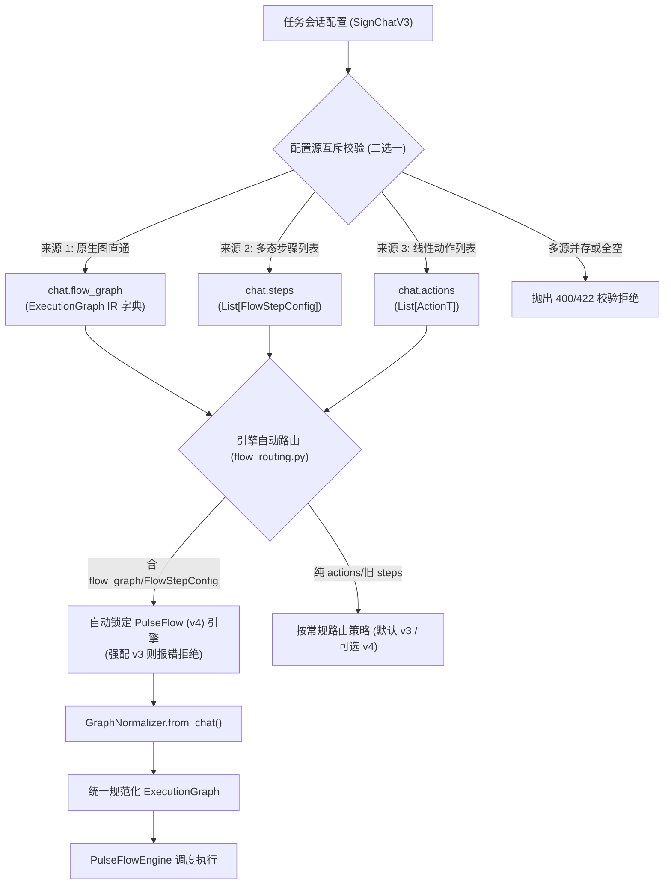

# 控制节点配置化设计规范 (Control Nodes Configuration Design)

## 1. 概述与背景
目前 TG-SignPulse 在底层执行引擎（`tg_signer/core/flow_models.py` 与 `tg_signer/core/flow_engine.py`）中已具备了完整的流程节点体系（`ActionNode`, `ConditionNode`, `WaitEventNode`, `DelayNode`, `ExtractorNode`, `SubflowNode`, `ParallelNode`）。
然而在任务配置层（`SignChatV3`、API、前端），任务配置仅能表达线性动作列表（`actions`）或单一动作步骤（旧版 `steps` 强约束 `action_type: SupportAction`），导致 `GraphNormalizer` 只能产出 `ActionNode`。

本规范定义**阶段一：控制节点配置化**的完整生产级架构，打通从任务配置到全部 7 种控制流节点的接线，同时保证历史任务 100% 平滑向后兼容、零隐性降级，并建立端到端的数据契约、安全资源限制与可视化预览闭环。

---

## 2. 总体架构与数据契约

### 2.1 三路输入互斥与自适应引擎路由
任务会话配置层（`SignChatV3`）支持三路独立的配置来源，并在模型层执行**严格的三选一互斥校验**：



#### 规则定义：
1. **合法性条件**：`flow_graph`、`steps`、`actions` 必须且只能有一个非空（非 None 且长度/节点数 > 0）。
2. **冲突拒绝**：若同时提供多个非空来源，直接抛出 `WorkflowConfigError`，杜绝静默覆盖。
3. **自适应引擎路由（解决 P0 崩溃点）**：
   - 在 `tg_signer/core/flow_routing.py: resolve_execution_engine` 中，若检测到会话使用了 `flow_graph` 或新控制节点 `FlowStepConfig`：
     - 若用户强制配置为经典引擎 `"v3"`：直接报错拒绝（经典引擎无法表达图结构）；
     - 否则：**自动提升路由为 `"v4"`（PulseFlow）**，彻底避免新任务因默认路由走 v3 而在运行时崩溃。

---

### 2.2 轨道一：原生图直通 (`flow_graph`)
在 `SignChatV3` 中新增：
```python
flow_graph: Optional[Dict[str, Any]] = None
```
- **契约定义**：结构严格符合 `ExecutionGraph` 模型字典（包含 `entry_node_id`, `nodes`, 可选 `max_total_steps`, `error_handler_node_id`, `resume_from_node_id`）。
- **拒绝未知节点类型（解决 P1 降级隐患）**：反序列化时严格校验 `node_type`，未知类型必须抛出异常拒绝，禁止静默降级为 `ActionNode`。

---

### 2.3 轨道二：多态步骤模型 (`FlowStepConfig`) 与分流解析器

为彻底解决 P0 级联合类型解析歧义（避免 Action 步骤的 `params` 被 `WorkflowStepConfig` 误判吞掉），采用**前置分流解析器（Pre-Validator）**：

```python
class FlowNodeType(str, Enum):
    ACTION = "action"
    CONDITION = "condition"
    WAIT_EVENT = "wait_event"
    DELAY = "delay"
    EXTRACTOR = "extractor"
    SUBFLOW = "subflow"
    PARALLEL = "parallel"


class FlowStepConfig(BaseModel):
    step_id: str
    node_type: FlowNodeType = FlowNodeType.ACTION
    name: Optional[str] = None
    next_step_id: Optional[str] = None
    on_failure_step_id: Optional[str] = None
    terminal_policy: TerminalPolicy = TerminalPolicy.IGNORE
    terminal_branch_target: Optional[str] = None
    run_if: Optional[str] = None
    skip_if: Optional[str] = None
    timeout_seconds: float = 25.0
    retry_policy: RetryPolicy = Field(default_factory=RetryPolicy)
    loop_policy: LoopPolicy = Field(default_factory=LoopPolicy)

    # 1. Action 专用
    action_type: Optional[SupportAction] = None
    params: Dict[str, Any] = Field(default_factory=dict)
    config: Optional[Dict[str, Any]] = None

    # 2. Condition 专用
    cases: List[Dict[str, str]] = Field(default_factory=list)
    default_target_id: Optional[str] = None

    # 3. WaitEvent 专用
    event_type: str = "NEW_MESSAGE"
    filter_patterns: List[str] = Field(default_factory=list)

    # 4. Delay 专用
    delay_seconds: float = 1.0

    # 5. Extractor 专用
    source_field: str = "prev.output"
    regex: str = ""
    export_vars: Dict[str, str] = Field(default_factory=dict)

    # 6. Subflow 专用
    subflow_graph: Optional[Dict[str, Any]] = None
    subflow_id: Optional[str] = None
    input_vars: Dict[str, str] = Field(default_factory=dict)
    output_vars: Dict[str, str] = Field(default_factory=dict)

    # 7. Parallel 专用
    branches: List[Dict[str, Any]] = Field(default_factory=list)
    parallel_mode: ParallelMode = ParallelMode.ALL
    max_concurrency: Optional[int] = None
    join_strategy: str = "merge"
```

#### Pre-Validator 分流策略：
在 `SignChatV3` 中针对 `steps` 字段引入逐元素检查：
```python
@validator("steps", pre=True)
def _parse_steps_discriminator(cls, v):
    if not v:
        return v
    parsed = []
    for item in v:
        if isinstance(item, (FlowStepConfig, WorkflowStepConfig)):
            parsed.append(item)
            continue
        if isinstance(item, dict):
            # 若显式指定 node_type，或包含新控制节点专有字段，则作为 FlowStepConfig 解析
            if "node_type" in item or any(k in item for k in ("cases", "filter_patterns", "delay_seconds", "regex", "subflow_graph", "branches")):
                parsed.append(FlowStepConfig(**item))
            else:
                parsed.append(WorkflowStepConfig(**item))
    return parsed
```

#### 双轨拓扑校验共存（解决 P0 旧校验丢失）：
- 若 `steps` 元素为旧版 `WorkflowStepConfig`：**完整保留并执行**原有 `initial_step_id` 必填检查、step_id 唯一性检查及 `WorkflowEngine.validate_topology`。
- 若 `steps` 包含 `FlowStepConfig` 或使用了 `flow_graph`：**执行 `GraphNormalizer.validate_graph`**，默认以首个步骤为入口，无需强求旧版 `initial_step_id`。

---

## 3. 7 类节点字段到 IR 的完整闭环映射与执行器接线

| 节点类型 | 配置字段 (`FlowStepConfig`) | 底层 IR 模型 (`flow_models.py`) | 转换与规范化规则 |
|---|---|---|---|
| **Action** | `action_type`, `params`, `config` | `ActionNode(action_type, params)` | 若提供 `config`，自动合并至 `params`；`action_type` 统一转大写枚举；**关键执行器接线**：根据 action_type 和 params 重建标准 `SignAction` 实例挂入 `metadata["raw_action"]`，使 `TelegramNodeExecutor` 能够正确分发 |
| **Condition** | `cases`, `default_target_id` | `ConditionNode(cases, default_target_id)` | target_id 自动解析哨兵（`COMPLETE` / `FAIL`）；cases 中的 target_id 必须通过拓扑存在性校验 |
| **WaitEvent** | `event_type`, `filter_patterns`, `timeout_seconds` | `WaitEventNode(event_type, filter_patterns)` | **关键注入**：Normalizer 必须自动从会话上下文注入 `metadata={"chat_id": chat.chat_id, "chat_name": chat.name}`，杜绝运行期找不到 chat_id 的问题 |
| **Delay** | `delay_seconds` | `DelayNode(seconds)` | `delay_seconds` 必须大于等于 0 且小于等于单步最大超时限制 |
| **Extractor** | `source_field`, `regex`, `export_vars` | `ExtractorNode(source_field, regex, export_vars)` | 静态编译验证 `regex` 正则表达式有效性，结合 `is_unsafe_keyword_regex` 杜绝 ReDoS 漏洞 |
| **Subflow** | `subflow_graph`, `input_vars`, `output_vars` | `SubflowNode(subflow_graph, ...)` | 递归反序列化并校验子图；禁止循环自引用；限制嵌套深度不超过 3 层 |
| **Parallel** | `branches`, `parallel_mode`, `max_concurrency`, `join_strategy` | `ParallelNode(branches, mode, max_concurrency, join_strategy)` | 递归校验每个分支子图；`parallel_mode` 映射为 `ParallelMode` 枚举；`max_concurrency` 范围校验 (1~10) |

### 执行步数预算动态对齐（解决 P1 步数超限）：
- 引擎默认单流程步数 `max_total_steps` 与图规模动态对齐：`max_total_steps = max(60, len(graph.nodes) * 2)`，确保即使 40 节点的复杂图也能完整推进。

---

## 4. 全图静态拓扑校验增强体系 (`validate_graph`)

静态拓扑校验必须覆盖全图连通性与资源安全边界：

1. **基本完整性校验**：
   - 节点列表非空，`entry_node_id` 存在于 `nodes` 中；
   - 节点 ID 必须符合命名规范，禁止使用哨兵保留字（`COMPLETE`, `FAIL`）。
2. **跳转指针（边）完整性**：
   - `next_node_id`, `on_failure_node_id`, `terminal_branch_target`, `cases[].target_id`, `default_target_id` 必须指向图中已存在的有效节点，或哨兵（`_TERMINAL_COMPLETE`, `_TERMINAL_FAIL`）。
3. **全图死循环检测 (Full Graph DFS)**：
   - 不仅从 `entry_node_id` 进行 DFS，而且对图中的**所有未访问连通分量**继续执行环路检测；
   - 若存在不可达孤立子图中的死循环（如 `dead_a -> dead_b -> dead_a`），坚决拦截报错；
   - 任何形成的环路，其中所有节点必须显式开启 `loop_policy.allow_loop=True` 且 `max_visits > 1`。
4. **不可达节点检查**：
   - 计算从 entry 可达的节点集，若存在不可达节点，在图校验中输出 Warning 提示。
5. **安全资源硬边界接线**：
   - `MAX_NODES_PER_GRAPH = 50`（单图最多 50 节点）；
   - `MAX_SUBFLOW_DEPTH = 3`（子流程嵌套最多 3 层）；
   - `MAX_PARALLEL_BRANCHES = 10`（并行分支最多 10 条）；
   - `MAX_TOTAL_TASK_NODES = 150`（全任务所有图累计最多 150 节点）；
   - `validate_graph` 必须显式执行上述常量上限校验，超标立即抛出 `GraphValidationError`。

---

## 5. 后端持久化、监听器与 API 规范

### 5.1 写入路径前置校验（保证“能写入即可加载执行”）
在 `backend/services/sign_task_crud.py: _validate_chats_workflow` 中：
- 对任何包含 `flow_graph` 或 `FlowStepConfig` 的任务，在写入持久化存储（落盘）前，**强制调用 `GraphNormalizer.from_chat(chat)` 并执行 `GraphNormalizer.validate_graph(graph)`**；
- 杜绝非法图被存入数据库后在调度执行时才爆雷。

### 5.2 监听器与 AI 动作递归防环扫描
更新 `backend/services/sign_task_config_inspect.py` 与 `tg_signer/config.py`：
- 编写递归生成器 `iter_all_flow_nodes(chat_or_graph, visited=None)`，引入 `visited` 集合防环；
- **WaitEvent 检测**：凡包含 `node_type == "wait_event"`，`task_requires_updates` 立即返回 True，同步更新 `SignChatV3.requires_updates`；
- **AI 动作检测**：递归扫描包含 AI 动作（如图片选择、计算题、图像识别）的节点，同步激活 `SignChatV3.requires_ai`，确保运行时 AI 配置正确预热；
- **ReDoS 安全校验**：`_validate_chats_regex_safety` 同步检测 `ExtractorNode.regex` 和 `WaitEventNode.filter_patterns`。

### 5.3 流程拓扑分析与预览 API (`preview-flow`)
在 `backend/api/routes/sign_tasks_v2.py` 提供端点：
- **请求格式**：`POST /api/v2/sign-tasks/preview-flow` 接收单个 `chat` 字典。
- **响应模型**：
```python
class FlowValidationIssue(BaseModel):
    level: str  # "error" | "warning"
    node_id: Optional[str] = None
    message: str

class PreviewFlowResponse(BaseModel):
    valid: bool
    node_count: int
    entry_node_id: Optional[str] = None
    mermaid: str
    errors: List[FlowValidationIssue] = []
    warnings: List[FlowValidationIssue] = []
```
- **Mermaid 安全转义**：
  - `to_mermaid` 中对所有节点名称、分支标签、条件表达式中的双引号、反斜杠、方括号与 HTML 标签进行严格实体转义，杜绝 XSS 注入。

---

## 6. 前端交互与数据契约对齐

1. **API 数据模型 (`frontend/src/lib/types.ts`)**：
   - 扩展 `SignTaskChat` 与 `TargetChatDraftLike`，显式加入 `flow_graph?: Record<string, any>` 与 `steps?: FlowStepConfig[]`。
2. **表单构建器对齐 (`frontend/src/lib/task-form-payload.ts`)**：
   - 对齐现有函数 `buildTaskFormPayload`；
   - 当表单处于高级流程模式（`flowMode: 'advanced'`）时，直接输出 `steps` 或 `flow_graph`，不再生成污染的假 `actions: []`；
   - 自动联动将任务的 `execution_engine` 设定为 `"v4"`。
3. **流程预览组件 (`FlowMermaidPreviewModal.vue`)**：
   - 接入 `preview-flow` API，支持展示结构化告警列表，并使用 `mermaid.render` 呈现安全的流程拓扑图。

---

## 7. 生产部署与安全验收基线

在代码合并与上线前，必须全部达成以下验收标准：
- [ ] 现有测试套件（`test_flow_compat`, `test_flow_normalizer`, `test_flow_adapter` 等）零回归，全部 PASS。
- [ ] 引擎路由（`flow_routing.py`）能正确将 `flow_graph` 与 `FlowStepConfig` 自动分流至 PulseFlow (v4)。
- [ ] `steps` 预分流解析器能精准区分新旧步骤，Action 节点的 `params` 不发生静默丢失。
- [ ] `WaitEventNode` 自动获得正确的 `chat_id` 与事件总线上下文。
- [ ] 7 类控制节点完整映射且动作节点可由 `TelegramNodeExecutor` 正常执行。
- [ ] 全连通分量 DFS 能准确拦截不可达死循环，资源预算常量（50/3/10/150）全面接线。
- [ ] 写入路径强制执行前置建图校验，API 返回结构化 `PreviewFlowResponse` 且 Mermaid 输出已转义。
- [ ] `task_requires_updates` 与 `requires_ai` 递归防环扫描准确无误。
