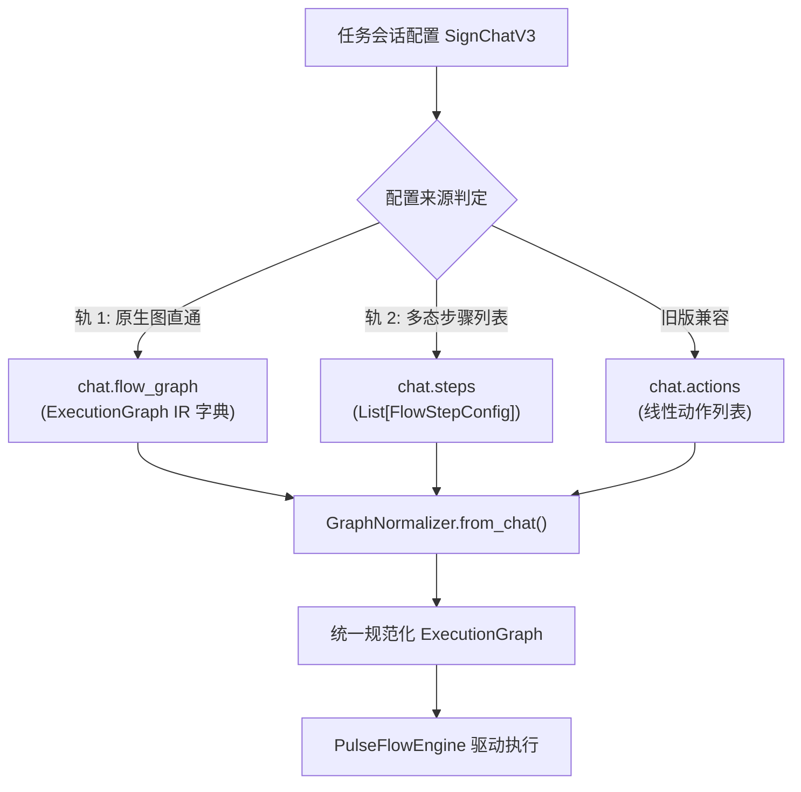

# 控制节点配置化设计规范 (Control Nodes Configuration Design)

## 1. 概述与背景
目前 TG-SignPulse 在底层执行引擎（`flow_models.py` 与 `flow_engine.py`）中已具备了完整的流程节点能力（`ActionNode`, `ConditionNode`, `WaitEventNode`, `DelayNode`, `ExtractorNode`, `SubflowNode`, `ParallelNode`）。
然而在任务配置层（`SignChatV3`、API、前端），任务仅能配置线性动作列表（`actions`）或单一动作步骤（`steps` 仅支持 `action_type`），导致 `GraphNormalizer` 只能产出 `ActionNode`。

本规范定义**阶段一：控制节点配置化**的完整架构，解决“从任务配置接线到这些高级控制节点”的问题，并建立端到端的数据契约与可视化预览闭环。

---

## 2. 总体架构与数据契约

采用**双轨并行配置模式**，向后完全兼容现有线性任务配置：



### 2.1 轨道一：原生图直通 (`flow_graph`)
在 `SignChatV3` 中新增可选字段：
```python
flow_graph: Optional[Dict[str, Any]] = None
```
- 当 `flow_graph` 存在且非空时，优先通过 `ExecutionGraph.from_dict(flow_graph)` 反序列化。
- 自动进行拓扑与死循环静态校验（`GraphNormalizer.validate_graph`）。
- 适用场景：高阶流程、脚本导入导出、复杂多分支与嵌套子图。

### 2.2 轨道二：多态步骤列表 (`FlowStepConfig`)
在 `tg_signer/config.py` 中将步骤模型升级为多态模型：
```python
class FlowNodeType(str, Enum):
    ACTION = "action"
    CONDITION = "condition"
    WAIT_EVENT = "wait_event"
    DELAY = "delay"
    EXTRACTOR = "extractor"
    SUBFLOW = "subflow"
    PARALLEL = "parallel"

class FlowStepConfig(BaseModel):
    step_id: str
    node_type: FlowNodeType = FlowNodeType.ACTION
    name: Optional[str] = None
    next_step_id: Optional[str] = None
    on_failure_step_id: Optional[str] = None
    terminal_policy: Optional[str] = "ignore"
    run_if: Optional[str] = None
    skip_if: Optional[str] = None
    allow_loop: bool = False
    max_retries: Optional[int] = None
    timeout_seconds: Optional[float] = 25.0

    # 1. Action 专用
    action_type: Optional[SupportAction] = None
    config: Dict[str, Any] = Field(default_factory=dict)

    # 2. Condition 专用
    cases: List[Dict[str, str]] = Field(default_factory=list)  # [{"condition": "...", "target_id": "..."}]
    default_target_id: Optional[str] = None

    # 3. WaitEvent 专用
    event_type: str = "NEW_MESSAGE"
    filter_patterns: List[str] = Field(default_factory=list)

    # 4. Delay 专用
    delay_seconds: float = 1.0

    # 5. Extractor 专用
    source_field: str = "prev.output"
    regex: str = ""
    export_vars: Dict[str, str] = Field(default_factory=dict)

    # 6. Subflow 专用
    subflow_graph: Optional[Dict[str, Any]] = None
    subflow_id: Optional[str] = None
    input_vars: Dict[str, str] = Field(default_factory=dict)
    output_vars: Dict[str, str] = Field(default_factory=dict)

    # 7. Parallel 专用
    branches: List[Dict[str, Any]] = Field(default_factory=list)
    parallel_mode: str = "all"  # "all" | "any" | "all_settled"
    max_concurrency: Optional[int] = None
```

- **向后兼容性**：
  若传入字典中未显式指定 `node_type`，但包含 `action_type` 或 `config`，则自动归一化为 `node_type = FlowNodeType.ACTION`。原有 `WorkflowStepConfig` 实例可自动安全互转。

---

## 3. GraphNormalizer 归一化逻辑升级

在 `tg_signer/core/flow_normalizer.py` 中升级 `from_chat`：
1. **优先级判定**：
   - 若 `chat.flow_graph` 存在且非空：调用 `_from_flow_graph(chat.flow_graph)`。
   - 若 `chat.steps` 存在且非空：调用 `_from_workflow_steps(chat)`，按照步骤的 `node_type` 分发生成对应的 `BaseFlowNode` 子类（`ActionNode`, `ConditionNode`, `WaitEventNode`, `DelayNode`, `ExtractorNode`, `SubflowNode`, `ParallelNode`）。
   - 否则：调用 `_from_linear_actions(chat)`，维持旧版兼容逻辑。
2. **拓扑校验增强**：
   - 保证所有控制节点的跳转目标（`cases[].target_id`, `default_target_id`, `next_node_id`, `on_failure_node_id`）均指向图中存在的有效节点或 `COMPLETE`/`FAIL` 哨兵。
   - 对嵌套的 `SubflowNode.subflow_graph` 和 `ParallelNode.branches` 递归执行静态循环与悬空边校验。

---

## 4. 后端 API 与服务层升级

1. **`backend/services/sign_task_config_build.py`**：
   - 保留并透传 `flow_graph` 与扩展后的 `steps` 结构。
   - 统一防注入清洗与校验。
2. **`backend/services/sign_task_config_inspect.py`**：
   - 更新 `task_requires_updates` 检查器：如果图中包含 `wait_event` 节点，同样标记为需要监听器支持。
3. **新增流程图导出 API**：
   - `POST /api/v2/sign-tasks/preview-flow`：接收 chat 配置，返回规范化后的 Mermaid 图形代码及静态校验结果（是否合法、节点数量、环路提示）。

---

## 5. 前端交互与可视化闭环

1. **类型定义扩展** (`frontend/src/lib/types.ts` & `sign-tasks.ts`)：
   - 扩展 `SignTaskChat`，支持 `flow_graph` 与 `steps: FlowStepConfig[]`。
2. **结构化流程编辑支持**：
   - 在任务编辑界面支持切换到“高级流程”模式。
   - 允许添加不同类型的步骤（动作、条件分支、事件等待、延迟、变量提取）。
3. **Mermaid 实时流程图预览**：
   - 提供流程图预览组件，根据当前步骤实时渲染流程拓扑图，直观展现分支条件与流转路径。

---

## 6. 测试与验收策略

1. **配置模型单元测试**：
   - 测试各类控制节点配置的解析、校验与向后兼容回退。
2. **GraphNormalizer 单元测试**：
   - 验证多态步骤列表正确转换为各类节点实例。
   - 验证 `flow_graph` 直通模式正确构建并校验。
   - 验证各类非法跳转和未允许环路被准确拦截。
3. **执行引擎集成测试**：
   - 验证由真实配置生成的包含 ConditionNode、WaitEventNode 的流程在 PulseFlow 引擎中顺畅推进。
4. **前端配置与渲染测试**：
   - 验证高级步骤配置生成的 Payload 结构及 Mermaid 预览渲染逻辑。
